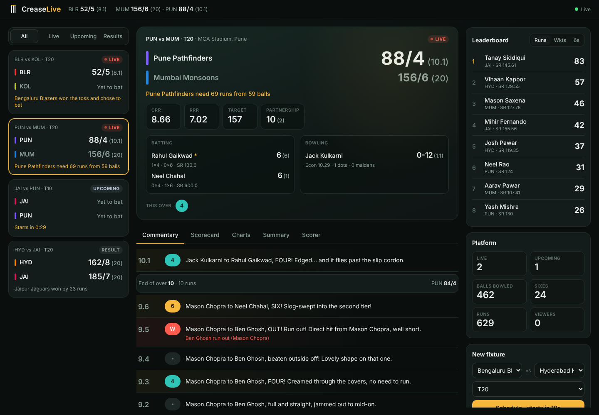
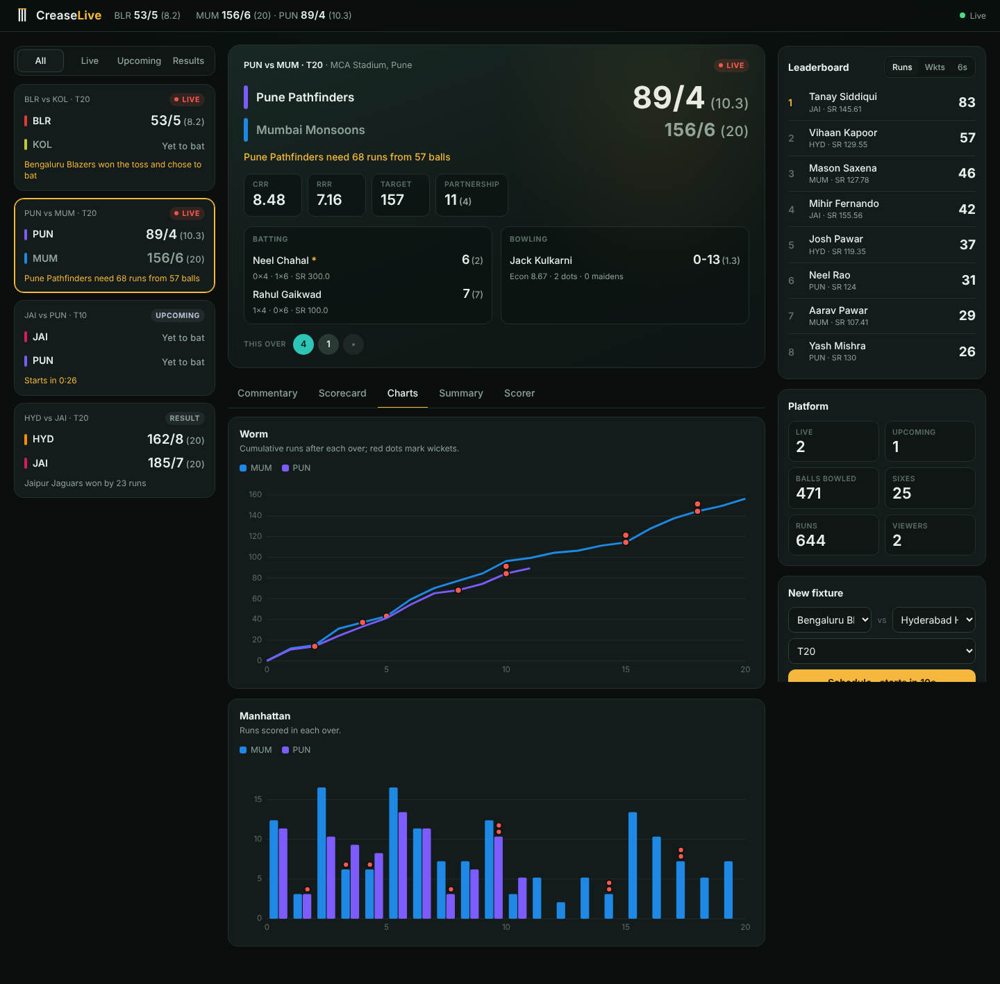
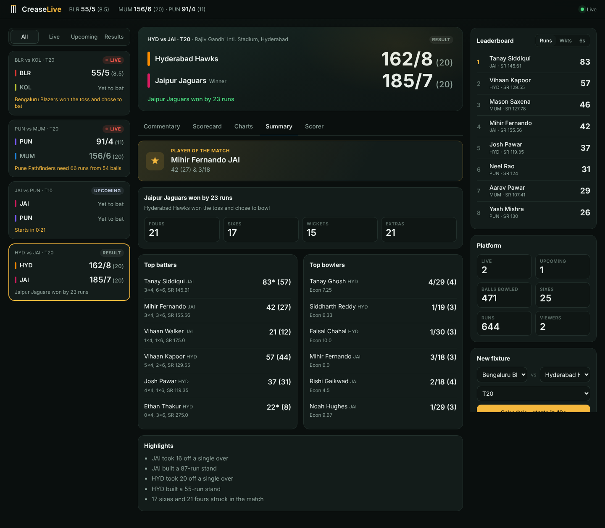
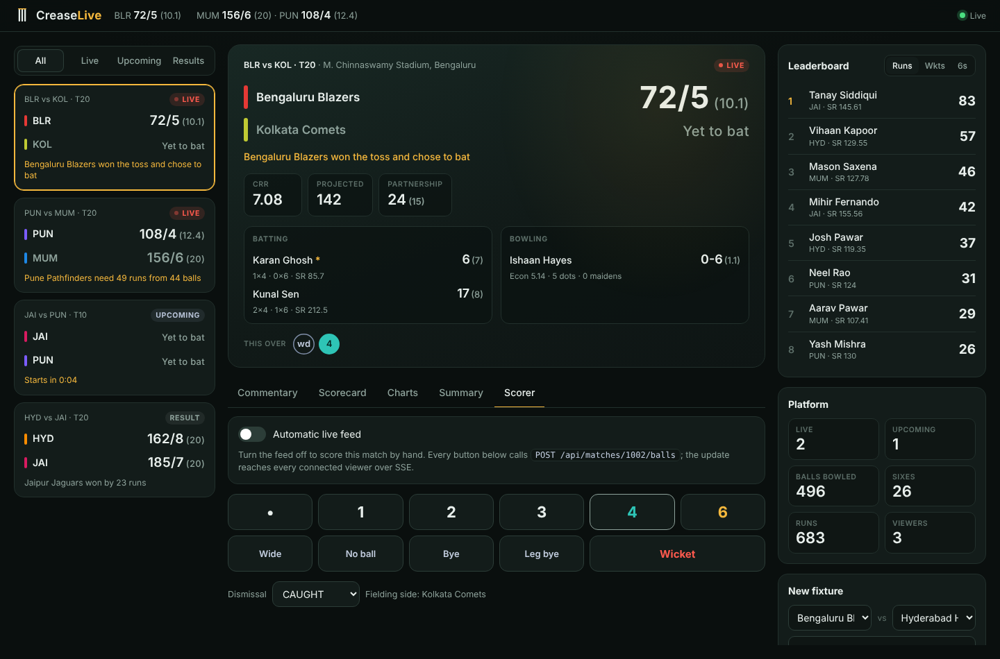
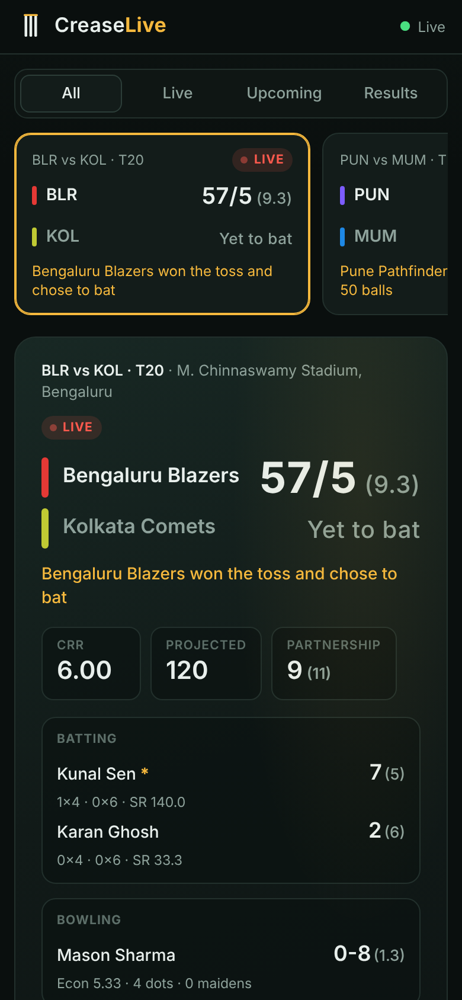

# Crease Live 🏏

A real-time cricket score management platform built with **Spring Boot 3 / Java 21**. It simulates a live
scoring feed for several concurrent matches, applies the Laws of cricket to every delivery, exposes
everything through a REST API, pushes updates to browsers with **Server-Sent Events**, and ships a
responsive dashboard with live scoreboards, ball-by-ball commentary, scorecards, charts, match summaries,
player statistics and a manual scorer console.



## Screenshots

| Charts | Match summary |
|---|---|
|  |  |

| Manual scorer | Mobile |
|---|---|
|  |  |

## Run it

```bash
mvn spring-boot:run
# open http://localhost:8080
```

Requirements: JDK 21+ and Maven 3.9+. No database or message broker needed.

On startup the app seeds six fictional franchises and four fixtures: a chase in progress, a first innings
in progress, a completed match, and a T10 that starts ~40 s after boot. The simulator then keeps at
least three fixtures live or upcoming, so the dashboard never goes quiet.

Run the tests with `mvn test`.

## Architecture

```
            ┌──────────── data sources ─────────────┐
            │ BallOutcomeGenerator   Scorer UI / API │   (any external feed can post here too)
            └───────────┬──────────────────┬────────┘
                        ▼                  ▼
 LiveMatchSimulator ─► MatchService ──(per-match lock)──► ScoringService (rules engine)
  @Scheduled tick        │  publishes MatchUpdatedEvent after commit
  + worker pool          ▼
                 LiveUpdateBroadcaster (@Async) ──► SSE: /api/stream, /api/matches/{id}/stream
                         │
                 ScorecardAssembler ── immutable snapshot, cached per match version
                         │
                 MatchInsightsService ── summaries, player stats, leaderboards (memoised)
                         │
                 REST controllers ──► JSON ──► dashboard (static/index.html)
```

### Why it scales

| Concern | Approach |
|---|---|
| Concurrent matches | Each `Match` owns a `ReentrantLock`; no global lock. The simulator dispatches one delivery per live match to a thread pool each tick and uses `tryLock`, so a busy match is skipped rather than queued. |
| Many readers | A scorecard snapshot is built **once per match version** and shared by every REST call and SSE subscriber. Reads never block scoring for longer than one snapshot build. |
| Push fan-out | SSE delivery runs on a separate executor (`@Async("broadcastExecutor")`), so slow clients never stall the scoring path. Dead connections are evicted on send failure and by a 15 s heartbeat. |
| Out-of-order updates | Every payload carries `version`; the client discards anything older than what it already shows. `GET /api/matches/{id}` also returns an `ETag`. |
| Analytics | Player stats and leaderboards are aggregated from cached snapshots and memoised against a fingerprint of all match versions. |
| Storage | `MatchRepository` is a port. The in-memory implementation can be replaced by Redis or a database without touching services or controllers. For multiple instances, swap the in-process event for Redis pub/sub or Kafka. |
| Memory | Completed matches beyond the most recent 12 are pruned automatically. |

### Cricket rules implemented

Legal deliveries and six-ball overs · wides and no-balls (1-run penalty, re-bowled, charged to bowler) ·
byes and leg-byes (not charged to bowler or batter) · no-ball counts as a ball faced, a wide does not ·
strike rotation on odd runs and at the end of each over · new batter takes strike after a dismissal ·
dismissals valid only on the right deliveries (e.g. only run out on a no-ball; stumped allowed on a wide) ·
run outs not credited to the bowler · no bowler bowls consecutive overs · per-bowler over quota
(`overs / 5`) · maidens, dot balls, partnerships, fall of wickets · innings end on all out / overs /
target reached · results by wickets (with balls left), by runs, or tie.

## REST API

| Method | Path | Description |
|---|---|---|
| GET | `/api/matches?status=LIVE\|UPCOMING\|COMPLETED` | Match cards, live first |
| GET | `/api/matches/{id}` | Full scorecard with live state (batters, bowler, CRR/RRR, this over) |
| GET | `/api/matches/{id}/commentary?limit=30&innings=2&before={seq}` | Ball-by-ball, newest first, pageable |
| GET | `/api/matches/{id}/summary` | Result, top performers, player of the match, highlights |
| GET | `/api/matches/{id}/stream` | **SSE**: `scorecard` and `ball` events for one match |
| POST | `/api/matches` | Create a fixture `{teamAId, teamBId, overs, venue?, startsInSeconds?, autoSimulate?}` |
| POST | `/api/matches/{id}/start` | Toss and first ball |
| PATCH | `/api/matches/{id}/simulation` | `{ "enabled": false }` pauses the automatic feed (manual scoring) |
| POST | `/api/matches/{id}/balls` | Record a delivery (see below) |
| DELETE | `/api/matches/{id}` | Remove a match |
| GET | `/api/teams`, `/api/teams/{id}` | Squads |
| GET | `/api/players/{id}` | Player profile, aggregate stats, recent matches |
| GET | `/api/players/leaderboard?type=runs\|wickets\|sixes\|strikerate\|economy&limit=10` | Leaderboards |
| GET | `/api/overview` | Platform counters (live matches, balls, runs, viewers) |
| GET | `/api/stream` | **SSE**: a `card` event whenever any match changes |
| GET | `/actuator/health`, `/actuator/metrics` | Ops endpoints |

Recording a delivery:

```bash
# four off the bat
curl -X POST localhost:8080/api/matches/1002/balls -H 'Content-Type: application/json' -d '{"batRuns":4}'
# wide that runs away for four more (5 wides)
curl -X POST localhost:8080/api/matches/1002/balls -H 'Content-Type: application/json' -d '{"extraType":"WIDE","extraRuns":4}'
# caught, naming the fielder
curl -X POST localhost:8080/api/matches/1002/balls -H 'Content-Type: application/json' -d '{"wicketType":"CAUGHT","fielderId":203}'
```

`extraType`: `NONE`, `WIDE`, `NO_BALL`, `BYE`, `LEG_BYE`. `wicketType`: `BOWLED`, `CAUGHT`, `LBW`,
`RUN_OUT`, `STUMPED`, `HIT_WICKET`. Optional `bowlerId` (start of an over only) and `commentary`.
Impossible deliveries return `422` with an RFC 7807 problem body; wrong match state returns `409`.

## Configuration (`application.yml`)

```yaml
cricket:
  simulation:
    enabled: true            # turn the automatic feed off entirely
    tick-millis: 2500        # pace of the live feed
    ball-probability: 0.85   # chance a live match bowls a ball on a tick
    auto-replenish: true     # keep scheduling new fixtures
    min-active-matches: 3
    default-overs: 20
    start-delay-seconds: 45
    seed-demo-data: true
```

The simulated feed shifts its outcome probabilities by phase (powerplay, middle, death overs), wickets in
hand and chase pressure. Across 500 simulated T20s it averages a first-innings total of about 155/7 with
chasing sides winning about half the time.

## Project layout

```
src/main/java/com/crease/live
├── config/        executors, CORS, simulation properties
├── domain/        Match, Innings, Team, Player, BallEvent, batting/bowling entries
├── repository/    match + team storage (in-memory, swappable)
├── service/       ScoringService (rules), MatchService, ScorecardAssembler, MatchInsightsService
├── simulation/    live feed generator, scheduler, squads, demo seeding
├── realtime/      SSE broadcaster, update events
├── view/          immutable API/stream read models
└── web/           REST controllers, request DTOs, error handling
src/main/resources/static   dashboard (HTML, CSS, vanilla JS + SVG charts, no build step)
```
